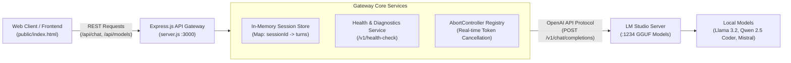

# 🔌 LM Studio Gateway: Node.js Proxy & Web Interface for Local LLMs

[](https://nodejs.org/)
[](https://expressjs.com/)
[](https://lmstudio.ai/)
[](LICENSE)

A lightweight **Express.js API Gateway and interactive web client** designed to interface with local Large Language Models served via **LM Studio's OpenAI-compatible HTTP server**.

Provides session management, multi-turn conversation caching, real-time health diagnostics, dynamic model discovery, and request cancellation.

---

## 🏗️ Architecture Overview



---

## 🌟 Key Features

### 1. Dynamic Model Discovery & Health Diagnostics
* **`/api/check-server`**: Probes the LM Studio daemon to verify host availability before dispatching compute-heavy inference requests.
* **`/api/check-models`**: Queries `/v1/models` to dynamically inspect loaded GGUF models, creation timestamps, and ownership metadata.

### 2. Conversational Session Management
* Maintains isolated in-memory multi-turn conversation histories keyed by `sessionId`.
* Automatically formats chat histories with system prompts and context turns for OpenAI-compatible completions.

### 3. Graceful Request Cancellation
* Uses JavaScript `AbortController` instances stored per active request.
* Enables users to immediately halt streaming generations or hung inference calls, freeing local GPU/CPU compute instantly.

### 4. Fully Configurable Network Topology
* Connects seamlessly to LM Studio whether running on `localhost` or across a local area network (LAN / Home Lab) via environment configuration.

---

## 📂 Project Structure

```text
LMSTUDIOCONNNECTOR/
├── server.js            # Core Express.js gateway, routing & proxy logic
├── public/              # Static frontend assets (HTML, CSS, client-side JS)
│   ├── index.html       # Web UI chat interface
│   ├── script.js        # DOM rendering & API communication
│   └── styles.css       # Clean user interface styling
├── package.json         # Node.js dependencies & execution scripts
├── .env.example         # Environment configuration template
└── test.py              # Python sanity script for testing endpoints
```

---

## 🚀 Quickstart Guide

### 1. Prerequisites
- **Node.js 18+** & **npm**
- **[LM Studio](https://lmstudio.ai/)** installed and running with local server enabled (default port `1234`).

### 2. Installation
```bash
git clone https://github.com/hongjarren/LMSTUDIOCONNNECTOR.git
cd LMSTUDIOCONNNECTOR

npm install
```

### 3. Environment Configuration
Copy the environment template:
```bash
cp .env.example .env
```
Ensure the URL matches your LM Studio host (default is `http://localhost:1234`):
```ini
PORT=3000
LM_STUDIO_URL=http://localhost:1234
```

### 4. Launch Application
```bash
# Production start
npm start

# Development mode (with nodemon auto-reload)
npm run dev
```

Open your browser at `http://localhost:3000` to interact with your local models!

---

## 📡 API Reference

| Endpoint | Method | Description |
| :--- | :--- | :--- |
| `/api/check-server` | `GET` | Health check probing LM Studio daemon connectivity. |
| `/api/check-models` | `POST` | Fetches currently loaded GGUF models from LM Studio. |
| `/api/chat` | `POST` | Dispatches conversation payload `{ message, sessionId, model }`. |
| `/api/cancel` | `POST` | Aborts an in-flight completion request for a given `sessionId`. |

---

## 📜 License
MIT License. Open for educational and personal usage.